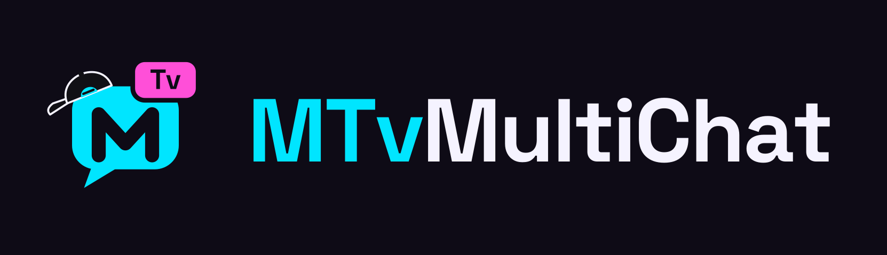

<p align="center"></p>

# MTv MultiChat

Chat unificado para directos: junta en una sola ventana los chats de **Twitch, YouTube, TikTok y Kick** y los muestra en OBS con un overlay de chat y otro de alertas que se configuran sin escribir código.

*Unified live chat for Twitch, YouTube, TikTok and Kick, with a moderation dock, a chat overlay and an alerts overlay for OBS. No code, no URL parameters. Windows; Spanish and English interface.*

## Apoya el proyecto

MTv MultiChat es gratuito. Si te resulta útil, puedes apoyar a Mafla en [Ko-fi](https://ko-fi.com/maflatv).

## Descarga e instalación

En la [última versión](https://github.com/maflatv/MTv-MultiChat/releases/latest) hay dos formas de usarlo:

- **Instalador (recomendado):** `MTv-MultiChat-Setup-<versión>.exe`. Se instala solo para tu usuario, sin permisos de administrador, con accesos directos en el escritorio y en el menú Inicio. **Se actualiza solo:** al abrirlo busca si hay una versión nueva y te avisa en la cabecera. Solo descarga si lo pides, y únicamente lo que ha cambiado. Tus ajustes están en `%APPDATA%\MTv MultiChat` y no se pierden al actualizar ni al desinstalar.
- **Portable:** `MTv-MultiChat.exe`, un solo archivo que no se instala. Ponlo en su propia carpeta: tus ajustes se guardan ahí. No se actualiza solo.

El programa no tiene firma digital, así que Windows puede mostrar un aviso: pulsa "Más información" y luego "Ejecutar de todas formas".

## Uso

1. **Conecta tus plataformas** en la columna izquierda: escribe tu canal o usuario y pulsa Conectar. YouTube y TikTok se conectan solos cada vez que empiezas un directo.
2. **Añade los overlays a OBS** (Fuente → Navegador). MTv MultiChat debe estar abierto mientras transmites.
   - Chat: `http://localhost:7390/overlay` (recomendado 450 × 800)
   - Alertas: `http://localhost:7390/alertas` (1920 × 1080; activa "Controlar audio mediante OBS")
3. **Personaliza** en el editor de la derecha, con vista previa al momento: estilos rápidos, colores, temas de color para los nombres, fuentes, disposición, filtros, y alertas con tus propios sonidos, imágenes, GIF o vídeos.
4. **Lectura en voz alta** (pestaña Voz): lee el chat y los eventos con las voces de Windows, con filtros por tipo, rol, importe mínimo, comandos y enlaces. Suena por los altavoces del PC; OBS la recoge con el audio del escritorio.
5. **Prueba** sin estar en directo con los botones de Probar o el envío automático de mensajes.

El botón **?** del dock tiene una guía rápida y los problemas frecuentes. El botón **Aa** cambia el idioma (español o inglés; en automático, el de Windows), que también se aplica a los textos que ven tus espectadores en los overlays.

## Principios

- **No se corta**: cada plataforma se conecta a su servicio de chat, no lee el diseño de su web. Funciona aunque minimices todo.
- **Todo en tu PC**: OBS carga `http://localhost`; los mensajes no pasan por servidores de terceros (salvo Kick con cuenta, ver más abajo).
- **Sin configuraciones raras**: todo se ajusta con controles y vista previa. La URL de OBS no lleva parámetros.
- **Eventos fiables**: donaciones con importe numérico y moneda, comparables entre plataformas.
- **Seguro**: el contenido del chat se pinta siempre como texto, nunca como HTML. El servidor solo acepta conexiones de este PC y rechaza órdenes de otras webs.

## Plataformas

| Plataforma | Qué trae |
|---|---|
| Twitch | Chat, emotes de Twitch, 7TV, BTTV y FFZ, bits, subs, regalos, raids y borrados de moderación, sin iniciar sesión. Con sesión (opcional, código en twitch.tv/activate): follows, canjes de puntos, avatares e insignias oficiales. |
| YouTube | Chat, emojis del canal, emotes de BTTV y 7TV, Super Chats y Super Stickers con importe y moneda, miembros, membresías regaladas, regalos y borrados. Sin clave de API ni cupo diario. Lee el "Chat en vivo" completo, no el "Top chat". |
| TikTok | Solo en la app de escritorio: chat con emotes, regalos (al final de cada racha, con monedas e imagen), follows y suscripciones. |
| Kick | **Con mi cuenta** (API oficial a través de un servidor puente, `puente-kick/`): chat, follows, subs, regalos, KICKs, canjes y baneos. **Sin cuenta** (solo app de escritorio): chat, subs, regalos, raids y borrados. Emotes de 7TV en los dos modos. |

## Desde el código

Requiere Node 22 o posterior. La app no tiene dependencias; Electron y las herramientas de compilación se descargan en `.build/` la primera vez.

```
iniciar.bat                    servidor y dock en el navegador
escritorio.bat                 app de escritorio (Electron)
npm test                       pruebas
node build/build-exe.js 1.1.0  instalador, portable y zip en dist/
```

Los cinco archivos de `dist/` (`MTv-MultiChat-Setup-X.Y.Z.exe`, su `.blockmap`, `latest.yml`, `MTv-MultiChat.exe` y el `.zip`) van en la release vX.Y.Z de GitHub. Sin `latest.yml` las versiones instaladas no se enteran de la nueva.

### Estructura

```
server.js                        servidor local: páginas, eventos en tiempo real (SSE) y órdenes del dock
desktop/main.js                  app de escritorio: ventana, actualizaciones y conectores que necesitan navegador
lib/mensaje.js                   formato común de mensaje
lib/bus.js                       centro de mensajes: repetidos, historial, borrados, destacado
lib/config.js                    configuración del usuario
lib/runtime.js                   dónde van los ajustes (código, portable o instalada) y versión
lib/medios.js                    sonidos e imágenes propios de las alertas
lib/emotes.js                    emotes de 7TV, BTTV y FFZ por plataforma
lib/moneda.js                    importes escritos → número, moneda y equivalente aproximado en USD
lib/prueba.js                    mensajes de prueba y envío automático
lib/voz.js                       qué se lee en voz alta y cómo se limpia el texto
lib/conectores/                  Twitch, YouTube, Kick y TikTok
app/                             dock, overlays de chat y alertas, iconos, sonidos de serie y marca
puente-kick/                     servidor puente de Kick (Cloudflare Worker), aparte de la app
docs/                            investigación de estilos de chat
test/                            pruebas
```

### Registrar las aplicaciones (una vez, quien publica)

**Twitch** (inicio de sesión opcional): en https://dev.twitch.tv/console/apps registra una aplicación `MTv MultiChat` con OAuth Redirect URL `http://localhost`, categoría `Application Integration` y **Client Type: Public**. Copia el Client ID en `CLIENT_ID_POR_DEFECTO` (`lib/conectores/twitch-cuenta.js`). El Client ID es público.

**Kick** (modo "Con mi cuenta"): sigue `puente-kick/LEEME.md` y pon la dirección del puente en `PUENTE_POR_DEFECTO` (`lib/conectores/kick.js`).

## Créditos

- Sonidos de alerta: [Kenney](https://kenney.nl) (CC0). Detalle en `app/sonidos/LEEME.md`.
- Logotipos de plataformas y redes: [Simple Icons](https://simpleicons.org) (CC0).
- Emotes: 7TV, BetterTTV y FrankerFaceZ (servicios públicos; los emotes son de sus autores).

## Licencia

MIT. Ver [LICENSE](LICENSE).
